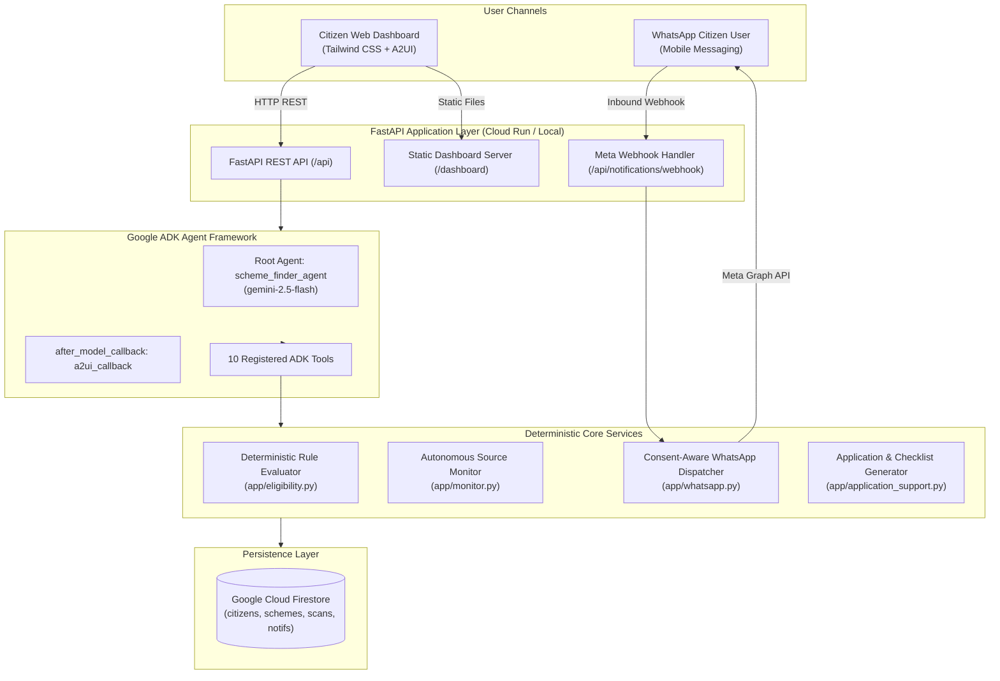

<div align="center">


# 🚀 Build with Gemini · Track 3

## 🏛️ Scheme Finder: Autonomous Government Benefits Discovery Agent

### *An AI-powered, agent-first platform that helps citizens discover welfare benefits, automatically assess eligibility using transparent deterministic rules, monitor official government portals with SHA-256 change detection, and receive timely notifications through consent-aware WhatsApp alerts.*

<br/>


<sub>Built for the **Google Cloud: Build with Gemini (Track 3: Agent-First Applications)** Hackathon & Project Gallery</sub>

</div>

---

## 📖 Table of Contents

- [🏛️ Part I: Scheme Finder — Autonomous Benefits Discovery Agent](#️-part-i-scheme-finder--autonomous-benefits-discovery-agent)
  - [🎯 Problem Statement & Mission](#-problem-statement--mission)
  - [🏗️ System Architecture](#-system-architecture)
  - [✨ Key Features & Capabilities](#-key-features--capabilities)
  - [👥 Synthetic Citizen Personas](#-synthetic-citizen-personas)
  - [📜 Verified Schemes & Statutory Caveats](#-verified-schemes--statutory-caveats)
  - [🔍 Official Source Monitoring & Change Detection](#-official-source-monitoring--change-detection)
  - [💬 Consent-Aware WhatsApp Integration](#-consent-aware-whatsapp-integration)
  - [🪟 Google ADK & A2UI Native Display](#-google-adk--a2ui-native-display)
  - [🧪 Verification & Test Results (53/53 Passing)](#-verification--test-results-5353-passing)
  - [⚡ Quickstart: Running Scheme Finder Locally](#-quickstart-running-scheme-finder-locally)
  - [📁 Repository Structure](#-repository-structure)
  - [🎙️ Demo Guide](#-demo-guide)
- [🚀 Part II: Build with Gemini Track 3 Workshop & Starter Kit](#-part-ii-build-with-gemini-track-3-workshop--starter-kit)
  - [🧩 Anatomy of a Track 3 Project](#-anatomy-of-a-track-3-project)
  - [📂 Featured Projects Gallery](#-featured-projects-gallery)
  - [🧠 What's in this Repo](#-whats-in-this-repo)
  - [🧰 Build Your Own](#-build-your-own)
  - [📚 Resources](#-resources)
  - [🤝 Contributing](#-contributing)
  - [📄 License](#-license)

---

# 🏛️ Part I: Scheme Finder — Autonomous Benefits Discovery Agent

## 🎯 Problem Statement & Mission

Every year, millions of eligible citizens miss out on life-changing government welfare benefits—such as financial stipends, health insurance, housing subsidies, and educational scholarships. The barriers are systemic:

1. **Information Asymmetry**: Schemes are fragmented across dozens of central ministries and state-level portals with no unified discovery mechanism.
2. **Opaque & Complex Rules**: Citizen eligibility criteria (income thresholds, landholdings, categorical exclusions) are buried in dense circulars that ordinary citizens cannot parse.
3. **Missed Deadlines & Silent Updates**: Governments regularly extend application windows or release supplemental guidelines, but citizens only learn about them after windows close.
4. **Channel Inaccessibility**: Disadvantaged populations frequently lack desktop internet access or computer literacy, relying primarily on mobile messaging platforms like WhatsApp.

**Scheme Finder** solves this by combining the reasoning power of **Google ADK** and **Gemini 2.5 Flash** with **100% deterministic legal eligibility evaluation**, autonomous portal change detection, and WhatsApp alert delivery that strictly respects citizen consent.

---

## 🏗️ System Architecture



---

## ✨ Key Features & Capabilities

### 1. 100% Deterministic Legal Rules Engine
- Evaluates citizen eligibility using rigorous Python logic ([`app/eligibility.py`](simple-agent/app/eligibility.py)), **never** relying on LLM hallucination for legal qualification.
- Classifies each match into: `likely_eligible`, `potentially_eligible`, `unlikely_eligible`, or `information_needed`.
- Computes satisfied conditions, failing conditions, and flags unverified requirements (e.g., land registry verification, certificate renewals) with transparency.

### 2. Autonomous Official Source Monitoring & Change Detection
- Periodically polls official `.gov.in` and `.nic.in` gazettes ([`app/monitor.py`](simple-agent/app/monitor.py)).
- Computes SHA-256 content hashes with whitespace normalization to eliminate duplicate notifications.
- Automatically flags updates such as **deadline extensions**, benefit adjustments, or criteria revisions.
- Strictly isolates non-whitelisted or unverified sources into an `under_review` quarantine.

### 3. Consent-Aware WhatsApp Integration
- Dual-mode delivery: Supports live **Meta WhatsApp Business Cloud API** and an interactive **in-browser simulator** for testing without credentials.
- **Strict Opt-Out Protection**: Automatically suppresses outgoing notifications for opted-out citizens with zero message leakage.
- Inbound conversational triage handling commands like *"Find schemes for me"*, *"Why am I eligible?"*, *"What documents do I need?"*, and *"Stop notifications"*.

### 4. Actionable Application Support Packets
- Generates tailored application checklists, required document guides, portal direct links, and submission deadlines.
- Flags official fee schedules (e.g., verifying that government scheme applications are 100% free of charge).

### 5. Interactive 9-Section Tailwind Dashboard & A2UI Display
- Full web frontend served directly at `/dashboard` displaying:
  1. Citizen Profiles & Personas
  2. Scheme Catalog (Central & State)
  3. Interactive Eligibility Screener
  4. Application Packet Generator
  5. Official Sources & Health Monitor
  6. Autonomous Scan Activity Logs
  7. WhatsApp Alert Center & Delivery Logs
  8. Interactive Mobile WhatsApp Chat Simulator
  9. Live ADK Agent Chat with visual A2UI cards

---

## 👥 Synthetic Citizen Personas

Scheme Finder includes five realistic synthetic personas to test diverse socio-economic criteria:

| Persona ID | Name | Age | State | Income | Profile Highlights | Target Schemes |
|---|---|---|---|---|---|---|
| `citizen-001` | **Ramesh Patel** | 42 | Gujarat | ₹1,20,000 | Small farmer (2.5 acres landholding) | PM-KISAN, PM-JAY |
| `citizen-002` | **Sunita Sharma** | 35 | Madhya Pradesh | ₹85,000 | Married woman, low-income household | Ladli Behna Yojana, PM-JAY |
| `citizen-003` | **Vikram Singh** | 22 | Rajasthan | ₹60,000 | Enrolled undergraduate student | PM Vidyalaxmi, State Scholarship |
| `citizen-004` | **Lakshmi Bai** | 68 | Karnataka | ₹40,000 | Elderly widow, BPL household | National Old Age Pension, PM-JAY |
| `citizen-005` | **Anand Kumar** | 52 | Maharashtra | ₹2,40,000 | Self-employed shopkeeper, WhatsApp Opted Out | Opt-Out Suppression Benchmark |

---

## 📜 Verified Schemes & Statutory Caveats

All active schemes are strictly grounded in authoritative central and state government circulars:

1. **PM-KISAN (Pradhan Mantri Kisan Samman Nidhi)**: ₹6,000/yr in 3 installments for landholding farmer families.
2. **PM-JAY (Ayushman Bharat)**: ₹5,00,000/yr secondary/tertiary health insurance for bottom 40% vulnerable families (SECC 2011).
3. **Mukhyamantri Ladli Behna Yojana (MP)**: ₹1,250/mo direct benefit transfer for eligible women aged 21–60 in Madhya Pradesh.
4. **PM SVANidhi**: Micro-credit collateral-free working capital loans (₹10,000 to ₹50,000) for urban street vendors.
5. **Delhi Ladli Scheme**: Financial assistance deposited in the name of girl children at schooling milestones (Delhi NCT only).
6. **National Social Assistance Programme (IGNOAPS)**: Monthly pension for BPL citizens aged 60+.

---

## 🔍 Official Source Monitoring & Change Detection

The monitoring daemon inspects verified public portals and computes deterministic SHA-256 hashes:

```
[Official Portal URL]
         │
         ▼
[HTTP Client with Timeout & Retry]
         │
         ▼
[Whitespace Normalization & SHA-256 Hash]
         │
         ├─── Hash Matches Previous? ──► [Duplicate Suppressed / No Spam]
         │
         └─── Hash Differs / New Content?
                     │
                     ▼
             [Schema Difference Detector]
                     │
                     ├── Deadline Extended ──► [Notify Matching Citizens]
                     ├── Benefit Changed   ──► [Flag Updated Scheme]
                     └── Source Inaccessible ─► [Mark Degraded, Alert Admin]
```

---

## 💬 Consent-Aware WhatsApp Integration

Scheme Finder supports both real Meta Cloud API dispatch and zero-dependency local simulation:

- **Opt-Out Safety Guarantee**: When a citizen replies `"STOP"` or has `whatsapp_opt_in = False`, notifications are marked `opted_out_suppressed` and zero network requests are dispatched.
- **Inbound Interactive Webhook**: Supports challenge handshake validation (`hub.mode=subscribe` and `hub.verify_token`) and secure `X-Hub-Signature-256` HMAC validation.
- **In-Browser Phone Simulator**: Interactive UI in the dashboard lets workshop judges test WhatsApp conversations in real time without requiring a Meta Developer account.

---

## 🪟 Google ADK & A2UI Native Display

Scheme Finder utilizes Google's **Agent Development Kit (ADK)**:
- **Model**: `gemini-2.5-flash` via Vertex AI Agent Platform.
- **A2UI Callback**: Transforms structured responses into Google A2UI card schemas (`AdaptiveCard`, `FactSet`, `Action.OpenUrl`).
- **10 Core Tools**: `assess_eligibility_tool`, `get_matching_schemes_tool`, `generate_application_packet_tool`, `get_upcoming_deadlines_tool`, `trigger_source_monitor_tool`, `send_whatsapp_notification_tool`, `update_whatsapp_preference_tool`, `get_official_sources_tool`, `get_scan_logs_tool`, and `search_schemes_tool`.

---

## 🧪 Verification & Test Results (53/53 Passing)

The complete automated test suite covers unit logic, integration flows, and end-to-end edge cases:

```bash
GOOGLE_CLOUD_PROJECT=qwiklabs-gcp-04-54fac5b784e7 uv run pytest tests/ -v
```

| Test Module | Coverage Area | Tests | Status |
|---|---|---|---|
| `tests/unit/test_eligibility.py` | Statutory criteria, income thresholds, state rules, missing attributes | 5 | ✅ 5/5 PASSED |
| `tests/unit/test_monitoring.py` | SHA-256 hashing, diffing, source authority verification, error recovery | 6 | ✅ 6/6 PASSED |
| `tests/unit/test_notifications.py` | WhatsApp formatter, simulator, opt-out suppression, error fallback | 6 | ✅ 6/6 PASSED |
| `tests/integration/test_agent.py` | ADK reasoning loop, tool execution, SSE streaming | 1 | ✅ 1/1 PASSED |
| `tests/integration/test_api_endpoints.py` | REST API routes, dashboard HTML serving, chat simulator | 4 | ✅ 4/4 PASSED |
| `tests/integration/test_scheme_finder_scenarios.py` | 12 end-to-end Track 3 workshop rubric scenarios | 17 | ✅ 17/17 PASSED |
| `tests/integration/test_server_e2e.py` | A2A streaming, Reasoning Engine endpoints, Agent Card metadata | 4 | ✅ 4/4 PASSED |
| `tests/integration/test_audit_gaps.py` | Stale data detection, HTTP 409 concurrency lock, Meta webhook handshake | 10 | ✅ 10/10 PASSED |
| **Total Test Suite** | **Full application coverage** | **53** | **✅ 53/53 PASSED (100%)** |

---

## ⚡ Quickstart: Running Scheme Finder Locally

### 1. Prerequisites
- Python 3.13+ installed
- `uv` package manager installed (`curl -LsSf https://astral.sh/uv/install.sh | sh`)
- Google Cloud Project with Vertex AI enabled (`gcloud auth login`)

### 2. Clone & Install
```bash
git clone https://github.com/shafiankhan/Scheme-finder.git
cd Scheme-finder/simple-agent
uv sync
```

### 3. Configure Environment Variables
```bash
cp .env.example .env
export GOOGLE_CLOUD_PROJECT="your-gcp-project-id"
export GOOGLE_CLOUD_LOCATION="global"
```

### 4. Run the Server
```bash
uv run python -m app.fast_api_app
```

The application runs at `http://localhost:8000`:
- **Web Dashboard**: [`http://localhost:8000/dashboard`](http://localhost:8000/dashboard)
- **Interactive OpenAPI Docs**: [`http://localhost:8000/docs`](http://localhost:8000/docs)
- **Health Check**: [`http://localhost:8000/api/health`](http://localhost:8000/api/health)

---

## 📁 Repository Structure

```text
Scheme-finder/
├── assets/
│   └── build-with-gemini-banner.png  # Build with Gemini official workshop banner
├── .agents/                          # Workshop skills and pre-configured MCP tools
├── DEMO_GUIDE.md                     # 5-minute hackathon pitch script & live demo flow
├── project_brief.md                  # Track 3 project brief & tool coverage checklist
├── README.md                         # This comprehensive showcase documentation
└── simple-agent/
    ├── Dockerfile                    # Production Cloud Run container buildfile
    ├── pyproject.toml                # Dependencies & configuration
    ├── agents-cli-manifest.yaml      # Agent Platform manifest
    ├── deploy/
    │   └── cloud_scheduler_job.yaml    # Declarative Cloud Scheduler cron job
    ├── docs/
    │   ├── CLOUD_SCHEDULER_SETUP.md    # Cloud Scheduler provisioning guide
    │   └── WHATSAPP_SETUP.md           # Meta WhatsApp Cloud API credentials guide
    ├── app/
    │   ├── agent.py                  # Google ADK Root Agent (10 tools & A2UI)
    │   ├── a2ui_utils.py             # Google A2UI card renderer
    │   ├── api_routes.py             # 19 REST API endpoints
    │   ├── application_support.py    # Application packet generation & deadlines
    │   ├── db.py                     # Cloud Firestore repository with fallback
    │   ├── eligibility.py            # Deterministic legal eligibility rules
    │   ├── fast_api_app.py           # FastAPI server & background scheduler
    │   ├── models.py                 # Pydantic schemas
    │   ├── monitor.py                # Official portal monitor & SHA-256 change detector
    │   ├── seed_data.py              # Personas & grounded schemes seed data
    │   ├── whatsapp.py               # WhatsApp Cloud API client & simulator
    │   └── static/
    │       └── index.html            # 9-section Tailwind CSS dashboard & simulator UI
    └── tests/
        ├── unit/                     # Unit tests (eligibility, monitor, notifications)
        └── integration/              # Integration tests, scenarios & audit gaps
```

---

## 🎙️ Demo Guide

For a step-by-step judge walkthrough, consult [`DEMO_GUIDE.md`](DEMO_GUIDE.md), which outlines a timed 5-minute live demo covering citizen eligibility assessments, WhatsApp simulator triage, official circular change detection, and ADK agent interactions.

---

# 🚀 Part II: Build with Gemini Track 3 Workshop & Starter Kit

Clone this repo, open [Antigravity](https://antigravity.google), and build your own agent-first app on Google Cloud. Every project in the [gallery below](#-featured-projects-gallery) was built the same way: prototyped with Antigravity and `agents-cli`, equipped with Memory, tools, and storage, deployed to Agent Platform, and given a face on Cloud Run.

<br/>

<sub>📖 <a href="https://cszhu.github.io/build-with-gemini/">Lab Guide</a> · 🛠️ <a href="https://google.github.io/agents-cli/guide/getting-started/">agents-cli</a> · 🤖 <a href="https://google.github.io/adk-docs/">ADK</a></sub>

---

## 🧩 Anatomy of a Track 3 Project

Every app in this collection is built from the same set of Google Cloud building blocks introduced in the lab. Once you understand this shape, you can read any project here at a glance:

| Layer | What it does | Powered by |
|---|---|---|
| 🤖 **The Agent** | The core reasoning loop | [ADK](https://google.github.io/adk-docs/) + [`agents-cli`](https://google.github.io/agents-cli/guide/getting-started/), scaffolded with [Antigravity](https://antigravity.google) |
| 🧠 **Memory** | Remembers facts across sessions | [Agent Platform Memory Bank](https://docs.cloud.google.com/gemini-enterprise-agent-platform/scale/memory-bank) |
| 🗄️ **Structured data** | Inventory, records, lists | [Firestore](https://console.cloud.google.com/firestore) |
| 🖼️ **Files & blobs** | Images, media, assets | [Cloud Storage](https://console.cloud.google.com/storage) |
| 🔧 **Tools** | Take real actions and fetch real data | ADK function tools |
| 🎨 **Media generation** | Creates images (and video) on demand | `gemini-3.1-flash-lite-image` (Nano Banana 2 Lite) · Omni (video) |
| 🧪 **Code sandbox** | Safely runs generated code | Agent Platform code execution |
| 🪟 **Agent-first UI** | Cards and tables instead of plain text | [A2UI](https://adk.dev/integrations/a2ui/) |
| 🌐 **Frontend** | A shareable web face | FastAPI proxy on [Cloud Run](https://cloud.google.com/run) |

---

## 📂 Featured Projects Gallery

A showcase of what workshop participants built with this lab. Entries are added here from the swag and gallery submission form after each event, so the categories below start empty and fill in over time. Browse them for inspiration, or [submit your own](#-contributing) once you've published your project with the `publish-to-github` skill.

### 🏛️ Civic Tech & Social Welfare Agents

- 🇮🇳 **[Scheme Finder](simple-agent/)**: Autonomous government benefits discovery agent that performs deterministic legal eligibility assessments, monitors official government portals with SHA-256 change detection, delivers consent-aware WhatsApp alerts, and presents rich A2UI cards across a comprehensive 9-section dashboard. <br/> <sub>Built for Build with Gemini Track 3 · See full documentation in [simple-agent/README.md](simple-agent/README.md)</sub>

### 🛍️ Commerce & Marketplace Agents

### 🍳 Food & Recipe Agents

- 🥫 **[Smart Pantry Recipe Concierge](https://github.com/matthewrose/buildwithgemini-smart-pantry-recipe-concierge)**: Tracks your pantry and recommends recipes grounded in a real recipe corpus. <br/> <sub>by [@matthewrose](https://github.com/matthewrose)</sub>

### ✈️ Travel & Local Agents

- ⛈️ **[SafeStageWX](https://github.com/felix1028/buildwithgemini-safestagewx)**: An agentic mobile app that helps event planners identify weather threats and climate risks for an event given its date and location, providing tailored preparedness timelines from months out down to hourly day-of forecasts. <br/> <sub>by [@felix1028](https://github.com/felix1028)</sub>
- 🌇 **[Sidewalk & Sun](https://github.com/OlafHaalstra/buildwithgemini-sidewalk-and-sun)**: Recommends sunny or shaded NYC spots from a curated 500-venue corpus, plotted on an interactive map. <br/> <sub>by [@OlafHaalstra](https://github.com/OlafHaalstra)</sub>

### 💪 Health, Fitness & Wellness Agents

- 🏊 **[TriCoach AI](https://github.com/common-aman/buildwithgemini-tricoach-ai)**: A triathlon coach that logs workouts, computes training zones, and generates motivational visuals. <br/> <sub>by [@common-aman](https://github.com/common-aman)</sub>

### 📚 Learning & Knowledge Agents

- 🎤 **[Interview Coach (PrepPal)](https://github.com/VineethBaradi/buildwithgemini-interview-coach)**: A mock-interview coach that runs LLM-driven practice sessions from a Firestore question bank and gives performance feedback. <br/> <sub>by [@VineethBaradi](https://github.com/VineethBaradi)</sub>

### 🎨 Creative & Media Agents

### 🏢 Productivity & Enterprise Agents

- 🔧 **[GitCraft](https://github.com/fpobletemu/buildwithgemini-gitcraft)**: A developer git assistant that inspects your repo and drafts Conventional-Commits-style messages, grounded in a commit-style guide. <br/> <sub>by [@fpobletemu](https://github.com/fpobletemu)</sub>
- 🖥️ **[IT Helpdesk Agent](https://github.com/NaweedAhmadi/buildwithgemini-it-helpdesk-agent)**: An IT support assistant that answers from a knowledge base and remembers context across sessions, with a ticket dashboard UI. <br/> <sub>by [@NaweedAhmadi](https://github.com/NaweedAhmadi)</sub>

### 🧪 Experimental & Other

- 🃏 **[Poker Agent](https://github.com/jakecho1108/buildwithgemini-poker-agent)**: A poker trainer with a real 800-iteration Monte Carlo equity engine and strategy tips grounded in a poker playbook. <br/> <sub>by [@jakecho1108](https://github.com/jakecho1108)</sub>

---

## 🧠 What's in this Repo

The `.agents/` folder teaches Antigravity how to build agents on Google Cloud.

### Skills

A **skill** is a bundle of instructions that loads automatically when it's relevant, so the agent gets the workflow right in fewer steps instead of rediscovering it each time.

| Skill | What it does |
| --- | --- |
| [`pick-your-agent-project`](.agents/skills/pick-your-agent-project/SKILL.md) | Brainstorm your app idea and write a project brief |
| [`troubleshoot-lab-setup`](.agents/skills/troubleshoot-lab-setup/SKILL.md) | Verify your environment and fix common setup errors |
| [`memory-bank-setup`](.agents/skills/setup-memory-bank/SKILL.md) | Add cross-session memory to your agent with Vertex AI Memory Bank |
| [`enable-a2ui`](.agents/skills/enable-a2ui/SKILL.md) | Make your agent reply with rich UI cards (A2UI) in the ADK dev UI |
| [`build-agent-frontend`](.agents/skills/build-agent-frontend/SKILL.md) | Generate a FastAPI chat frontend and ship it to Cloud Run |
| [`record-demo`](.agents/skills/record-demo/SKILL.md) | Record a branded demo video of your agent, with an optional AI soundtrack |
| [`publish-to-github`](.agents/skills/publish-to-github/SKILL.md) | Publish your finished project to your own GitHub and submit it for swag |

### Pre-configured tools (MCP)

[`.agents/mcp_config.json`](.agents/mcp_config.json) wires up two [Model Context Protocol](https://modelcontextprotocol.io/) servers that authenticate with your gcloud credentials, so the agent can look things up instead of guessing:

- **Firebase**: work directly with Firestore and other Firebase services
- **Google Developer Knowledge**: grounded access to Google's official docs (Cloud, Firebase, ADK, Agent Platform)

### Layout

```text
.agents/
├── mcp_config.json    # Firebase + Developer Knowledge MCP servers
├── rules/             # workspace rules (only deploy when asked)
└── skills/            # the workshop skills listed above
```

---

## 🧰 Build Your Own

The full, step-by-step walkthrough lives on the **[lab guide](https://cszhu.github.io/build-with-gemini/)**. This is the short version.

**Prerequisites** (the lab workstation comes with all of this pre-installed; you'll need it if you're running on your own machine):

- A **Google Cloud project** with billing enabled
- **[Antigravity](https://antigravity.google)** (`agy`), the coding agent that loads the skills above
- **[agents-cli](https://google.github.io/agents-cli/guide/getting-started/)**, built on the [Agent Development Kit (ADK)](https://google.github.io/adk-docs/)
- Authenticated gcloud: `gcloud auth login` and `gcloud auth application-default login`
- A personal **GitHub account** for the final publish-and-submit step

**Quickstart:**

```bash
git clone https://github.com/cszhu/build-with-gemini
cd build-with-gemini
agy
```

On startup, Antigravity scans the `.agents/` folder and loads the skills and tools above automatically. In the AGY prompt:

```text
/skills            # see the installed skills
/mcp               # confirm the firebase + google-developer-knowledge tools are connected
```

```text
Verify my setup.   # runs the troubleshoot-lab-setup skill to check your environment
```

Then follow the [lab guide](https://cszhu.github.io/build-with-gemini/) to design, build, deploy, and share your agent, start to finish.

---

## 📚 Resources

- **[Lab guide](https://cszhu.github.io/build-with-gemini/)**: the step-by-step workshop
- [Antigravity](https://antigravity.google)
- [agents-cli](https://google.github.io/agents-cli/guide/getting-started/)
- [Agent Development Kit (ADK)](https://google.github.io/adk-docs/)
- [Gemini Enterprise Agent Platform](https://docs.cloud.google.com/gemini-enterprise-agent-platform)

---

## 🤝 Contributing

**Built something?** Publish it with the `publish-to-github` skill and submit it through the form it gives you. Submissions get you swag, and standout projects get added to the [Featured Projects](#-featured-projects-gallery) gallery above.

**Found a bug?** If you hit a rough edge in a skill or the lab, please [open an issue](https://github.com/cszhu/build-with-gemini/issues).

---

## 📄 License

This is not an officially supported Google product and is provided for the Build with Gemini workshop for demonstration purposes only.
