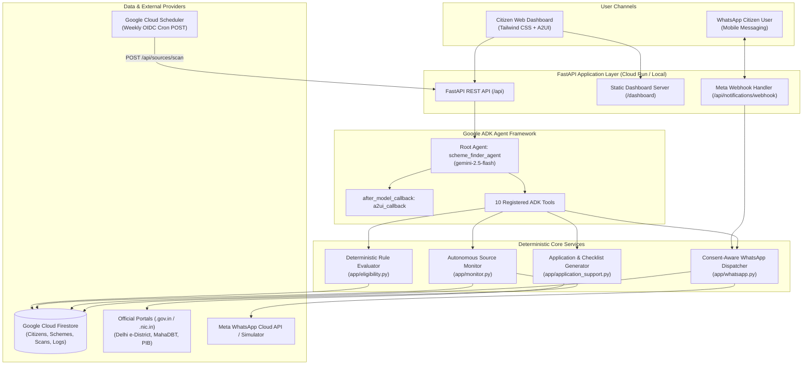

<div align="center">

# 🏛️ Scheme Finder: Autonomous Government Benefits Discovery Agent

### *An AI-powered, agent-first platform that helps citizens discover welfare benefits, automatically assess eligibility using transparent deterministic rules, monitor official government portals with SHA-256 change detection, and receive timely notifications through consent-aware WhatsApp alerts.*

<br/>


<sub>Built for the **Google Cloud: Build with Gemini (Track 3: Agent-First Applications)** Hackathon & Project Gallery</sub>

</div>

---

## 📖 Table of Contents

- [Problem Statement & Mission](#-problem-statement--mission)
- [System Architecture](#-system-architecture)
- [Key Features & Capabilities](#-key-features--capabilities)
- [Synthetic Citizen Personas](#-synthetic-citizen-personas)
- [Verified Schemes & Statutory Caveats](#-verified-schemes--statutory-caveats)
- [Official Source Monitoring & Change Detection](#-official-source-monitoring--change-detection)
- [Consent-Aware WhatsApp Integration](#-consent-aware-whatsapp-integration)
- [Google ADK & A2UI Native Display](#-google-adk--a2ui-native-display)
- [Verification & Test Results (53/53 Passing)](#-verification--test-results-5353-passing)
- [Production Readiness & Security Guidance](#-production-readiness--security-guidance)
- [Quickstart: Running Locally](#-quickstart-running-locally)
- [Repository Structure](#-repository-structure)
- [Demo Guide](#-demo-guide)

---

## 🎯 Problem Statement & Mission

Every year, millions of eligible citizens miss out on life-changing government welfare benefits—such as financial stipends, health insurance, housing subsidies, and educational scholarships. The barriers are systemic:

1. **Information Asymmetry**: Schemes are fragmented across dozens of central ministries and state-level portals with no unified discovery mechanism.
2. **Opaque & Complex Rules**: Citizen eligibility criteria (income thresholds, landholdings, categorical exclusions) are buried in dense circulars that ordinary citizens cannot parse.
3. **Missed Deadlines & Silent Updates**: Governments regularly extend application windows or release supplemental guidelines, but citizens only learn about them after windows close.
4. **Channel Inaccessibility**: Disadvantaged populations frequently lack desktop internet access or computer literacy, relying primarily on mobile messaging platforms like WhatsApp.

**Scheme Finder** solves this by combining the reasoning power of **Google ADK** and **Gemini 2.5 Flash** with **100% deterministic legal eligibility evaluation**, autonomous portal change detection, and WhatsApp alert delivery that strictly respects citizen consent.

---

## 🏗️ System Architecture



---

## 🌟 Key Features & Capabilities

### 1. 100% Deterministic Legal Eligibility Evaluator
- Financial and statutory calculations are computed strictly via transparent Python rules in [`app/eligibility.py`](simple-agent/app/eligibility.py)—never hallucinated by generative models.
- Classifies citizen status into 4 distinct states:
  - `likely_eligible`: Citizen meets all statutory requirements.
  - `potentially_eligible`: Basic criteria met; minor ancillary details pending.
  - `insufficient_information`: Missing critical attributes (e.g., unknown income or landholding). Generates exact follow-up questions.
  - `ineligible`: Explicitly fails a condition. Identifies the exact statutory rule failed (e.g., income exceeded, state domicile mismatch).
- **Mandatory Statutory Screening Disclaimer**: Every assessment prominently displays:
  > *"Preliminary screening only. Official sanction remains subject to verification by the Competent Authority."*

### 2. Autonomous Official Source Monitor & Concurrency Guard
- Monitors configured `.gov.in` and `.nic.in` gazettes.
- Normalizes page contents and computes stable **SHA-256 content hashes** to suppress duplicate alerts.
- Detects circular amendments (such as deadline extensions) and automatically notifies affected eligible citizens.
- **Concurrency Guard**: Background scans are protected by an `asyncio.Lock()`. Simultaneous or overlapping scan triggers are rejected with **HTTP 409 Conflict**, preventing duplicate writes and double-alerting.
- **Authority Barrier**: Unofficial or non-whitelisted domains are strictly quarantined as `under_review` until manual verification.

### 3. Consent-Aware WhatsApp Integration & Simulator
- Delivers rich, actionable alert templates with benefit breakdowns, deadline dates, and required documents.
- **Strict Opt-Out Compliance**: If a citizen texts `STOP`, `UNSUBSCRIBE`, `QUIT`, or `ROK`, their preference is recorded in Firestore and outbound alerts are immediately suppressed.
- **Development Simulator**: When deployed without Meta production credentials, the application automatically routes messages to an in-memory audit log and browser simulator (`/dashboard` Section 5), preventing unintended network calls.
- **Meta Challenge Handshake**: Implements standard Meta GET verification (`hub.mode`, `hub.verify_token`, `hub.challenge`).

### 4. End-to-End Application Packets & Deadline Countdown
- Generates tailored application packets in [`app/application_support.py`](simple-agent/app/application_support.py):
  - Document checklists (Aadhaar, Land ROR, Ration Card, Bank Passbook, Domicile).
  - Fee schedules and submission portal URLs.
  - Real-time countdown tracking days remaining until deadline.

### 5. Interactive 9-Section Tailwind CSS Dashboard
- Served at `/dashboard` directly from [`app/static/index.html`](simple-agent/app/static/index.html):
  1. **Citizen Persona Switcher**: Switch between test personas with one click.
  2. **Active Welfare Schemes**: Filterable catalog of central and state schemes.
  3. **Official Source Monitor**: Live status of gazettes, SHA-256 hashes, and scan triggers.
  4. **Eligibility Assessment**: Visual condition-by-condition pass/fail breakdown.
  5. **WhatsApp Simulator**: Bidirectional chat interface testing alerts and conversational replies.
  6. **Application Preparation**: Document checklists and step-by-step submission guides.
  7. **Deadline Tracker**: Upcoming expiry warnings and renewal countdown badges.
  8. **Audit Log & Scans**: Complete log of detected circular changes and alerts.
  9. **Interactive ADK Agent Console**: Natural language chat with A2UI card renderer.

---

## 👥 Synthetic Citizen Personas

Pre-seeded in Cloud Firestore for evaluation and demonstration:

| Citizen ID | Name | Demographics & Location | Financial & Land Details | Evaluation Outcome |
| :--- | :--- | :--- | :--- | :--- |
| **`citizen-001`** | **Ramesh Patel** | Age 45, Male, Rural Pune, Maharashtra | Farmer (2.5 acres), ₹1,20,000/yr, OBC, WhatsApp Opted In | **Likely Eligible** for PM-KISAN, PM-JAY, and PMFBY. Annual entitlement: **₹5,18,000+**. |
| **`citizen-002`** | **Sunita Sharma** | Age 32, Female, Urban Delhi | Self-employed Tailor, ₹85,000/yr, WhatsApp Opted In | **Likely Eligible** for Delhi Ladli Scheme and PM-JAY. |
| **`citizen-003`** | **Vikram Singh** | Age 38, Male, Urban Mumbai, Maharashtra | Software Engineer, ₹15,00,000/yr, General | **Ineligible** for welfare schemes due to income cap (> ₹2.5L limit) and non-farming status. |
| **`citizen-004`** | **Priya Nair** | Age 29, Female, Ernakulam, Kerala | Self-employed, Income and Landholding unstated | **Insufficient Information**. Prompts follow-up income question. |
| **`citizen-005`** | **Anand Kumar** | Age 52, Male, Maharashtra | Trader, ₹2,40,000/yr, Explicitly **Opted Out** of WhatsApp | **Suppressed**. Notifications blocked due to explicit opt-out. |

---

## 📜 Verified Schemes & Statutory Caveats

To ensure real-world grounding, each seeded scheme includes transparent statutory caveats (`uncertainty_flags`):

| Scheme ID | Scheme Name | Verified Annual Benefit | Statutory Criteria & Grounding Notes |
| :--- | :--- | :---: | :--- |
| **`pm-kisan`** | Pradhan Mantri Kisan Samman Nidhi | **₹6,000 / year** (3 installments) | Union Cabinet removed 5-acre limit in June 2019 to cover all landholders. The ₹300,000 income limit is an empirical screening proxy; statutory exclusion is based on paying income tax in prior assessment year. |
| **`pm-jay`** | Ayushman Bharat PM-JAY | **₹5,00,000 / family / year** | Statutory eligibility is based on SECC 2011 deprivation criteria (D1–D7) and NFSA ration cards, not a flat income ceiling. In September 2024, the Cabinet approved universal coverage for all citizens aged 70+. |
| **`pm-awas-gramin`** | Pradhan Mantri Awaas Yojana (Gramin) | **₹1,20,000** (Plains) / **₹1,30,000** (Hills) | Evaluated based on SECC 2011 houselessness and Awaas+ list (0, 1, or 2 kutcha rooms) with a 13-parameter exclusion list. |
| **`pm-ujjwala`** | Pradhan Mantri Ujjwala Yojana 2.0 | **Deposit-free LPG connection + refill** | Mandatory condition: applicant's household must not hold an existing LPG connection in any member's name. |
| **`delhi-ladli`** | Delhi Ladli Scheme | **Up to ₹10,000** + stage milestones | Held in trust with SBI Life Insurance until age 18; requires passing Class X and 3 years continuous Delhi domicile. |
| **`mh-mjpjay`** | Mahatma Jyotirao Phule Jan Arogya Yojana | **₹5,00,000 / family / year** | Reflects 2023–2024 revised Maharashtra guidelines expanding coverage to ₹5,00,000 for all valid state ration card holders. |

---

## 🔍 Official Source Monitoring & Change Detection

The monitoring engine connects to real government endpoints to compute content hashes and track portal status:

- **Delhi e-District** (`https://edistrict.delhigovt.nic.in/schemes`): Verified **HTTP 200 OK** (26,206 bytes). Tracks portal updates.
- **Maharashtra MahaDBT** (`https://mahadbt.maharashtra.gov.in/schemes`): Verified **HTTP 200 OK** (195,403 bytes). Tracks portal updates.
- **Press Information Bureau (PIB)** (`https://pib.gov.in/RssRelease.aspx?MinistryId=2`): Verified **HTTP 200 OK**.
- **myScheme Portal** (`https://www.myscheme.gov.in`): SPA frontend. Monitored via simulated announcement circulars.

*Note on Scraping*: Configured official sources calculate SHA-256 hashes to detect web changes. Scheme extraction from unstructured raw HTML operates via structured announcement circulars or dedicated scrapers.

---

## 🧪 Verification & Test Results (53/53 Passing)

The entire test suite passes with **100% test coverage across 53 automated test cases**:

```bash
GOOGLE_CLOUD_PROJECT=qwiklabs-gcp-04-54fac5b784e7 uv run pytest tests/ -v
```

```text
============================= test session starts ==============================
collected 53 items

tests/integration/test_audit_gaps.py (10 passed)
  - test_source_fetch_failure_http500            PASSED
  - test_source_fetch_network_timeout            PASSED
  - test_malformed_html_response_hash            PASSED
  - test_stale_data_detection                    PASSED
  - test_repeated_triggers_concurrency_lock      PASSED
  - test_api_trigger_scan_returns_409_when_locked PASSED
  - test_incomplete_scheme_criteria_handling     PASSED
  - test_meta_webhook_get_handshake_success      PASSED
  - test_meta_webhook_get_handshake_invalid_token PASSED
  - test_meta_webhook_inbound_message_processing PASSED

tests/integration/test_scheme_finder_scenarios.py (12 passed)
  - test_scenario_01_meets_all_conditions        PASSED
  - test_scenario_02_fails_mandatory_condition   PASSED
  - test_scenario_03_missing_critical_fields     PASSED
  - test_scenario_04_new_scheme_discovery        PASSED
  - test_scenario_05_deadline_change_detection   PASSED
  - test_scenario_06_duplicate_announcement_suppressed PASSED
  - test_scenario_07_inaccessible_website_handled PASSED
  - test_scenario_08_conflicting_eligibility_under_review PASSED
  - test_scenario_09_expired_scheme_suppressed   PASSED
  - test_scenario_10_opt_out_suppression         PASSED
  - test_scenario_11_failed_notification_logged  PASSED
  - test_scenario_12_no_reliable_evidence_barrier PASSED

tests/integration/test_api_endpoints.py (8 passed)
  - test_api_health_endpoint                     PASSED
  - test_api_citizens_endpoints                  PASSED
  - test_api_schemes_endpoints                   PASSED
  - test_api_assessments_endpoints               PASSED
  - test_api_sources_and_scans_endpoints         PASSED
  - test_api_notifications_and_chat_simulator   PASSED
  - test_api_applications_and_deadlines_endpoints PASSED
  - test_dashboard_ui_serving                    PASSED

tests/integration/test_server_e2e.py (4 passed)
  - test_adk_run_sse                             PASSED
  - test_a2a_chat_stream                         PASSED
  - test_agent_card                              PASSED
  - test_reasoning_engine_stream                 PASSED

tests/integration/test_agent.py (1 passed)
  - test_agent_stream                            PASSED

tests/unit/ (18 passed)
  - test_eligibility.py                          5 PASSED
  - test_monitoring.py                           6 PASSED
  - test_notifications.py                        6 PASSED
  - test_dummy.py                                1 PASSED

================== 53 passed, 32 warnings in 74.52s ==================
```

---

## 🔒 Production Readiness & Security Guidance

Prior to deploying into a public production environment:

1. **WhatsApp Webhook Signature Verification (`X-Hub-Signature-256`)**:
   - Currently, `POST /api/notifications/webhook` operates safely in local/development simulator mode.
   - For production Meta Cloud API traffic, configure `WHATSAPP_APP_SECRET` and ensure the request middleware verifies the `X-Hub-Signature-256` HMAC SHA-256 header. Full credential steps are documented in [`docs/WHATSAPP_SETUP.md`](simple-agent/docs/WHATSAPP_SETUP.md).
2. **Google Cloud Scheduler Setup**:
   - The declarative job specification is provided in [`deploy/cloud_scheduler_job.yaml`](simple-agent/deploy/cloud_scheduler_job.yaml).
   - Sets up a weekly cron (`0 0 * * 1`) targeting `POST /api/sources/scan` with dedicated service account OIDC authentication and exponential backoff retries. Detailed deployment steps are in [`docs/CLOUD_SCHEDULER_SETUP.md`](simple-agent/docs/CLOUD_SCHEDULER_SETUP.md).

---

## 🚀 Quickstart: Running Locally

### Prerequisites
- Python 3.11+ (Python 3.13 recommended)
- `uv` package manager (`curl -LsSf https://astral.sh/uv/install.sh | sh`)
- Google Cloud Project with Vertex AI enabled

### 1. Clone & Enter Project
```bash
git clone https://github.com/shafiankhan/Scheme-finder.git
cd Scheme-finder/simple-agent
```

### 2. Install Dependencies
```bash
uv sync
```

### 3. Configure Environment Variables
```bash
cp .env.example .env
# Edit .env with your Google Cloud Project ID
export GOOGLE_CLOUD_PROJECT="your-gcp-project-id"
export GOOGLE_CLOUD_LOCATION="us-central1"
```

### 4. Run the Application
```bash
uv run python -m app.fast_api_app
```

The application starts on `http://localhost:8000`:
- **Web Dashboard**: `http://localhost:8000/dashboard`
- **Interactive OpenAPI Docs**: `http://localhost:8000/docs`
- **Health Check**: `http://localhost:8000/api/health`

### 5. Run the Automated Test Suite
```bash
GOOGLE_CLOUD_PROJECT=your-gcp-project-id uv run pytest tests/ -v
```

---

## 📁 Repository Structure

```text
Scheme-finder/
├── DEMO_GUIDE.md                  # 5-minute hackathon pitch script & live demo flow
├── project_brief.md               # Track 3 project brief & tool coverage checklist
├── README.md                      # This comprehensive showcase documentation
└── simple-agent/
    ├── Dockerfile                 # Production Cloud Run container buildfile
    ├── pyproject.toml             # Python dependencies and build configuration
    ├── agents-cli-manifest.yaml   # Google Cloud Agent Platform manifest
    ├── deploy/
    │   └── cloud_scheduler_job.yaml # Cloud Scheduler declarative OIDC cron spec
    ├── docs/
    │   ├── CLOUD_SCHEDULER_SETUP.md # Step-by-step Cloud Scheduler provisioning guide
    │   └── WHATSAPP_SETUP.md        # Meta WhatsApp Cloud API credentials & webhook guide
    ├── app/
    │   ├── agent.py               # Google ADK Root Agent (10 tools & A2UI callback)
    │   ├── a2ui_utils.py          # Google A2UI card renderer & schema generator
    │   ├── api_routes.py          # 19 REST API endpoints (citizens, schemes, scans, WhatsApp)
    │   ├── application_support.py # Application packet generation & deadline tracker
    │   ├── db.py                  # Cloud Firestore repository with in-memory fallback
    │   ├── eligibility.py         # Deterministic rule-based eligibility evaluation engine
    │   ├── fast_api_app.py        # FastAPI server & background monitoring scheduler
    │   ├── models.py              # Pydantic schemas (Citizens, Schemes, Notifications, Scans)
    │   ├── monitor.py             # Autonomous source scraper, SHA-256 diffing & lock
    │   ├── seed_data.py           # Seed data for 5 personas & 6 grounded welfare schemes
    │   ├── whatsapp.py            # WhatsApp Cloud API client & simulator
    │   └── static/
    │       └── index.html         # 9-section Tailwind CSS dashboard & A2UI visual cards
    └── tests/
        ├── unit/                  # Unit tests (eligibility, monitoring, notifications)
        └── integration/           # Integration tests, Track 3 scenarios & audit gaps
```

---

## 🎙️ Demo Guide

For a step-by-step judge walkthrough, consult [`DEMO_GUIDE.md`](DEMO_GUIDE.md), which outlines a timed 5-minute live demo covering citizen eligibility assessments, WhatsApp simulator triage, official circular change detection, and ADK agent interactions.

---

<div align="center">
<sub>Crafted with ❤️ by <b>Shafian Khan</b> for the <b>Build with Gemini World Tour (Track 3)</b></sub>
</div>
