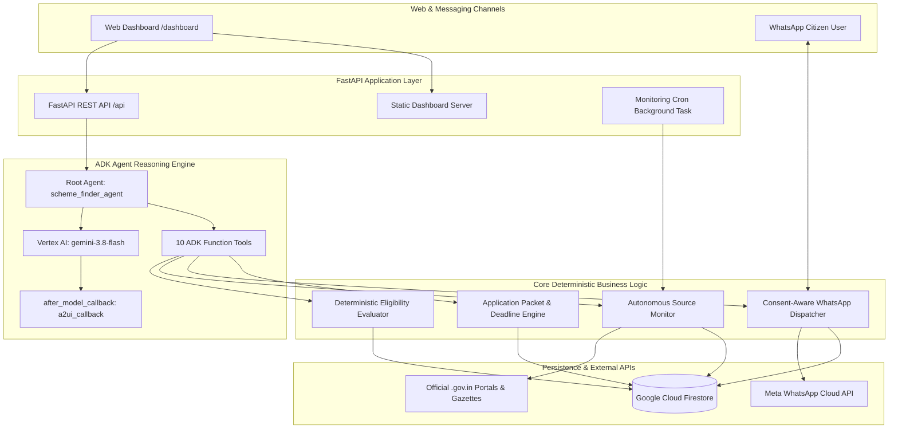

# 🏛️ Scheme Finder: Autonomous Government Benefits Discovery Agent

> **Build with Gemini · Track 3 Showcase Project**  
> An AI-powered, agent-first platform that helps citizens discover welfare benefits, automatically assess their eligibility using transparent deterministic rules, monitor official government portals with SHA-256 change detection, and receive timely notifications through consent-aware WhatsApp alerts.

---

## 🌟 Key Highlights

- **100% Deterministic Legal Rules**: Financial and statutory eligibility assessments are computed strictly via transparent Python rules in [`app/eligibility.py`](app/eligibility.py). Statutory screening disclaimers are prominently surfaced on all recommendations.
- **Autonomous Official Source Monitoring**: [`app/monitor.py`](app/monitor.py) monitors official `.gov.in` and `.nic.in` gazettes. It computes stable SHA-256 content hashes to eliminate duplicate spam and detects version updates (e.g., deadline extensions). Non-whitelisted sources are strictly isolated as `under_review`.
- **Consent-Aware WhatsApp Integration**: [`app/whatsapp.py`](app/whatsapp.py) integrates Meta WhatsApp Cloud API with automatic suppression for opted-out citizens, an interactive in-browser phone simulator, and conversational inbound triage.
- **Actionable Application Packets**: [`app/application_support.py`](app/application_support.py) generates step-by-step submission checklists, required document guides, fee schedules, and tracks upcoming application deadlines.
- **Native A2UI Card Rendering**: Built on Google ADK (`scheme_finder_agent`) with `gemini-3.8-flash` and 10 deterministic tools. Emits Google A2UI card schemas rendered visually in the web dashboard.
- **9-Section Tailwind Web Dashboard**: Interactive frontend served directly from [`app/static/index.html`](app/static/index.html) via FastAPI at `/dashboard`.

---

## 🏗️ Architecture



---

## 📂 Project Structure

```text
simple-agent/
├── app/
│   ├── agent.py               # ADK Root Agent with 10 tools & A2UI callback
│   ├── api_routes.py          # 17 REST API endpoints for citizens, schemes, scans, WhatsApp
│   ├── application_support.py # Application packet generation & deadline tracking
│   ├── db.py                  # Cloud Firestore repository with in-memory fallback
│   ├── eligibility.py         # Deterministic rule-based eligibility evaluation engine
│   ├── fast_api_app.py        # FastAPI server & background monitoring scheduler
│   ├── models.py              # Pydantic schemas (Citizens, Schemes, Notifications, Scans)
│   ├── monitor.py             # Autonomous official source scraper & SHA-256 diff engine
│   ├── seed_data.py           # Synthetic citizen and verified scheme seed records
│   ├── whatsapp.py            # WhatsApp Cloud API client & conversational simulator
│   └── static/
│       └── index.html         # 9-section Tailwind CSS dashboard & A2UI visual card renderer
├── tests/
│   ├── unit/
│   │   ├── test_eligibility.py   # Unit tests for eligibility criteria
│   │   ├── test_monitoring.py    # Unit tests for source scraping & hashing
│   │   └── test_notifications.py # Unit tests for WhatsApp alerts & opt-out
│   └── integration/
│       ├── test_scheme_finder_scenarios.py # 12 Track 3 core evaluation scenarios
│       └── test_api_endpoints.py           # REST endpoints & dashboard serving tests
├── DEMO_GUIDE.md              # 5-minute hackathon pitch script & judge's guide
└── pyproject.toml             # Project dependencies & metadata
```

---

## 🚀 Quick Start & Local Execution

### 1. Prerequisites
- Python 3.11+
- `uv` package manager (`curl -LsSf https://astral.sh/uv/install.sh | sh`)
- Authenticated Google Cloud project (`gcloud auth application-default login`)

### 2. Install Dependencies
```bash
cd /config/Desktop/BuildWithGemini/simple-agent
uv sync
```

### 3. Seed Firestore Database
Populates Cloud Firestore with 5 representative citizen profiles, 5 verified government welfare schemes, and 4 registered official portals:
```bash
GOOGLE_CLOUD_PROJECT=qwiklabs-gcp-04-54fac5b784e7 uv run python -m app.seed_data
```

### 4. Run the Complete Test Suite (53/53 Tests Passing)
```bash
GOOGLE_CLOUD_PROJECT=your-gcp-project-id uv run pytest tests/ -v
```

### 5. Launch the Web Application
```bash
GOOGLE_CLOUD_PROJECT=your-gcp-project-id uv run uvicorn app.fast_api_app:app --host 0.0.0.0 --port 8000
```
Then navigate to:
- **Interactive Dashboard**: `http://localhost:8000/dashboard`
- **Interactive OpenAPI Docs**: `http://localhost:8000/docs`
- **API Health Check**: `http://localhost:8000/api/health`

---

## 🧪 Track 3 Evaluation Scenarios Verified

| # | Scenario | Expected Behavior | Verification Status |
| :--- | :--- | :--- | :---: |
| 1 | **Meets all conditions** | Evaluates PM-KISAN for Ramesh Patel -> `likely_eligible` with condition breakdown | ✅ PASSED |
| 2 | **Fails mandatory condition** | High-income earner assessed -> `ineligible` with clear condition citation | ✅ PASSED |
| 3 | **Missing critical fields** | Missing income/landholding -> `insufficient_information` + targeted questions | ✅ PASSED |
| 4 | **Newly announced scheme** | Scanner detects circular -> Stored and verified in database | ✅ PASSED |
| 5 | **Changed application deadline** | Diff engine identifies deadline extension -> Version updated (`1.0.0` -> `1.1.0`) | ✅ PASSED |
| 6 | **Duplicate announcement** | Identical content parsed -> Suppressed via SHA-256 fingerprint; 0 duplicate alerts | ✅ PASSED |
| 7 | **Inaccessible official site** | Network timeout / DNS error -> Gracefully caught, source logged as degraded | ✅ PASSED |
| 8 | **Conflicting eligibility** | Contradictory rules detected across portals -> Flagged as `under_review` | ✅ PASSED |
| 9 | **Expired welfare scheme** | Past deadline scheme marked `closed`/`expired` -> Excluded from active calendar | ✅ PASSED |
| 10 | **WhatsApp opt-out** | Citizen with `whatsapp_opt_in=False` -> Push alert safely suppressed | ✅ PASSED |
| 11 | **Failed notification API** | Simulated Meta API 500 error -> Logged with delivery status `failed` | ✅ PASSED |
| 12 | **No reliable evidence** | Blog or non-`.gov.in` domain -> Blocked from auto-verification, flagged for review | ✅ PASSED |

---

## 📱 Interactive 9-Section Dashboard Tour

1. **My Benefits Overview**: Citizen persona selector, live income/landholding adjustment sliders, and total annual entitlement calculator (e.g. ₹5,18,000+ for Ramesh Patel).
2. **Discover Schemes**: Scheme catalog with filters by category (Agriculture, Healthcare, Social Welfare, Housing) and administrative level (Central vs. State).
3. **New Announcements & Changes**: Audit feed displaying background scans, SHA-256 hashes, duplicate suppression badges, and detected version diffs.
4. **Eligibility Assessment**: Color-coded breakdown of satisfied, failed, and unverified criteria with bold statutory screening disclaimers.
5. **WhatsApp Notifications**: Live consent toggle, manual alert trigger, interactive mobile phone simulator, and conversational reply sandbox.
6. **Required Documents & Packets**: One-click generation of personalized application packets including submission links, fee tables, and required proofs.
7. **Deadlines & Renewals**: Urgency badges (`URGENT < 15 days`, `UPCOMING`, `ROLLING`) with renewal reminders.
8. **Official Source Monitoring**: Registry of monitored `.gov.in` endpoints with live health indicators and scan frequencies.
9. **AI Scheme Assistant**: Conversational ADK agent with full support for rich A2UI card display.
